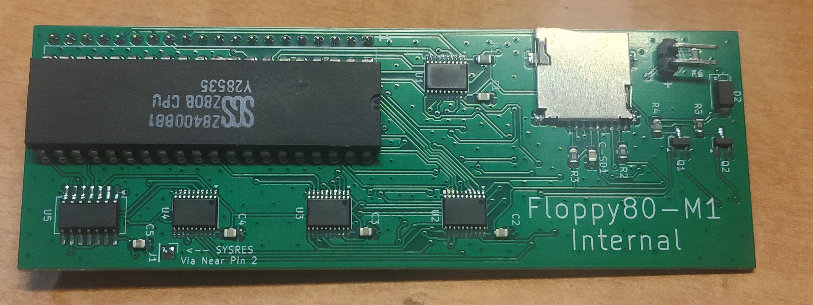
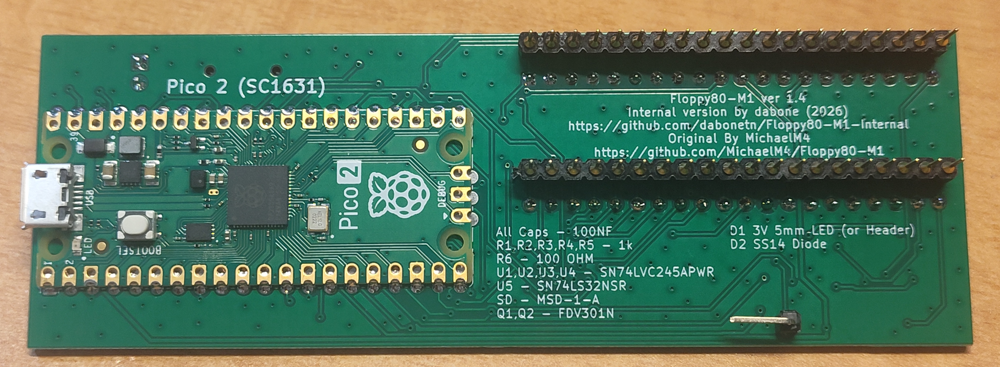
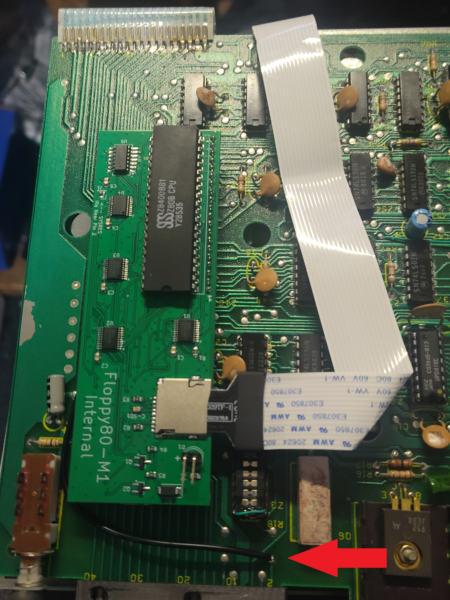

# Floppy 80 for the TRS-80 Model I - Internal Version

This is my take on the PCB for the Floppy80-M1.
It's a internal version that plugs into the Z80 socket.

I've made no changes to the firmware or docs from the source github project.  
If you try my boards and have issues,  

#**DON'T GO COMPLANING to MichaelM4.**

Please open a issue here.

Board version 1.45 has been built and tested.
Works with my Level 2 Model One.

WILL NOT FIT CORRECTLY WITH THE CPU IN A SOCKET!!!!!

AGAIN

WILL NOT FIT CORRECTLY WITH THE CPU IN A SOCKET!!!!!

This is very similar to what happens when using a Sprinter II clone, it does fit, but bends the board.

The board requires you to remove the CPU, and install the board into place.
It also requires a jumper wire from the via located on pin 2 of the edge connector. (Sysres* signal)
I highly recommend a microsd extension to mount the card outside of your case.
I have used it with a 18" (48cm) MicroSD Extension Cable from Aliexpress.

Build notes.
For the pin headers, I snip the headers that go under the cpu flush with the board and then solder them, it allows a much closer fit for the cpu.
(If you have a junk board, use that to get the length correct, so you don't nick your board with the flush cutters)
For the sysres header, if you are using a pin header, use a 90 degree header mounted on the underside of the board. Mounting on the top hits the bottom case.

JLCPCB Gerbers are under the Production directory.

BOM

Qty 4 - SN74LVC245APWR (Tssop-20)  
Qty 1 - SN74LS32 SOIC or SOP16 Footprint.  
Qty 5 - 0805 1k Resistor  
Qty 1 - 0805 100 Ohm Resistor  
Qty 6 - 0805 .1uf Capacitor  
Qty 2 - FDV301N, SSM3K324R, or 2N7002 Mosfets.  
Qty 1 - SS14 Diode  
Qty 1 - LED (5mm 3.3v compatible.) or you can substitue a 2.54 header to locate the led elsewhere.  
Qty 1 - MSD-1-A MicroSD Card Slot.  
Qty 1 - Right angle pin header, and wire for the sysres* signal from pin 2 of the edge connector.  

This is not a beginners soldering project, the ics are very small.

Here are some pics.

On this picture you can see the only flying header needed. 
Just solder a wire from here to the SYSRES* connector.

(This is the end of my changes to the readme.md)

## Features

The Floppy-80 is a Hardware and software solution that emulates 
the following features of the Expansion Interface
- A Floppy Disc controller
  - supports 3 floppy drives
  - single and double-density
  - single and double-sided
  - up to 90 cylinders
  - DMK disk format supported
- 32k RAM expansion (optional)
- 40Hz RTC interrupt generation

Additionally, the following features are provided:
- A Hard Disk Controller (optional)
  - supports up to 2 hard drives
  - Uses same image format as FreHD
- Wait State Generation (optional)
- Software Debugging Interface

An SD card is required to store disk images and configuration data

## Hardware

The Floppy-80 consists of a board that connects to the Model-1 expansion edge connector.
The board contains an SD card socket to provide disk images and a
Raspberry Pi Pico 2 microcontroller which does the emulation

[Building and testing](HARDWARE.md) the board is covered separately.

## Software

The software provided includes 2 main components
* Firmware running on Raspberry Pi, that provides the emulation
* FDC Utility (TRS DOS, and CPM) running on TRS-80 for emulator control

See the separate [Software Build Guide](BUILDING.md) for details on 
building the Floppy-80 software

## User Guide

For User Instructions please see the separate [User Guide](USER-GUIDE.md)

## Credits

## Resources